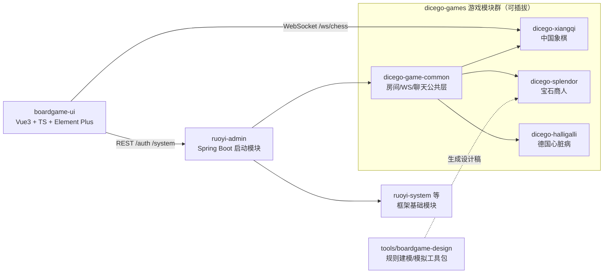

<p align="center">
  
</p>

<h1 align="center">DiceGo · 线上桌游对战平台</h1>

<p align="center">
  <a href="https://spring.io/projects/spring-boot"></a>
  <a href="https://openjdk.org/"></a>
  <a href="https://cn.vuejs.org/"></a>
  <a href="https://vitejs.dev/"></a>
  <a href="https://vitest.dev/"></a>
  <a href="./LICENSE"></a>
</p>

DiceGo 是一个面向多人实时对战的**线上桌游平台**：登录后进入大厅，按"分区 → 游戏 → 房间"逐层点进去，创建或加入房间，通过 WebSocket 与好友实时对局和聊天。

平台采用**游戏模块化架构**——每款桌游是一个独立的 Maven 模块，公共的房间管理、WebSocket 连接、聊天与清理机制沉淀在 `game-common` 公共层，新增一款游戏只需实现规则引擎本身。除对战功能外，还内建了一套**桌游设计工作台**（游戏规则结构化建模、数值模拟、规则书导出），设计稿可直接反哺平台的游戏接入。

## ✨ 核心功能

| 功能 | 说明 |
|---|---|
| 用户体系 | 注册 / 登录（图形验证码）、Sa-Token + JWT 会话、个人资料 |
| 大厅三级导航 | 7 大桌游分区（派对/家庭/策略/卡牌/叙事等）+ 机制标签；URL query 记忆层级，刷新/分享不丢位置 |
| 房间系统 | 创建房间 / 房间号快捷加入 / 房间列表 5s 轮询；房间按等待/对局/结束状态分级自动清理 |
| 实时对局 | WebSocket 长连接：走子、聊天、心跳；断线重连不误清在线状态，同名玩家跨房间不互踢 |
| 🀄 中国象棋（已上线） | 完整走子规则引擎、将军判定、悔棋、认输、重新开局、红黑座位 |
| 💎 宝石商人 Splendor（已上线） | 宝石/发展卡/贵族全流程，预留卡隐藏视角，支持 2–4 人 |
| 🔔 德国心脏病 Halli Galli（已上线） | 2–6 人实时抢铃：服务端到达顺序仲裁、10s 超时代翻、抢错赔牌、两人残局特判；四果图标 + Web Audio 合成音效 |
| 🎲 桌游设计工作台 | 前端 `/design` 页面 + `tools/boardgame-design` Node 工具包：`game.yaml` 结构化规则建模、平衡性模拟、规则书与植入要点导出 |

## 🧩 架构



**游戏模块分层**：`GameRoom` / `GameRoomManager` 泛型基类负责房间生命周期与定时清理，`AbstractGameWebSocketHandler` 统一 WS 连接管理与消息协议；具体游戏模块只实现规则引擎与座位逻辑，互不感知。

**关键模块一览**

| 模块 | 职责 |
|---|---|
| `ruoyi-admin` | 后端启动入口（Jetty :8080），聚合所有模块 |
| `dicego-games/dicego-game-common` | 游戏公共层：房间生命周期、WebSocket 基类、聊天、领域对象（RoomVO/GameMessage 等） |
| `dicego-games/dicego-xiangqi` | 中国象棋：走子引擎、座位、悔棋/认输/重开 |
| `dicego-games/dicego-splendor` | 宝石商人对战：卡牌/贵族缓存、回合引擎、个性化快照 |
| `dicego-games/dicego-halligalli` | 德国心脏病：56 张牌引擎、并发抢铃仲裁、超时代翻、全量快照 |
| `boardgame-ui` | 前端 SPA：登录注册、大厅三级导航、对局页、设计工作台 |
| `tools/boardgame-design` | 桌游规则结构化建模（TypeScript schema）与模拟工具包 |
| `design/` | 设计工作区：每款游戏 `game.yaml`/规则书/模拟报告；`samples/` 收录 7 款成熟桌游的结构化拆解 |

## 🛠 技术栈

| 层 | 技术 |
|---|---|
| 后端 | Spring Boot 4.1 · RuoYi-Vue-Plus 6.0 脚手架 · JDK 21 · Jetty |
| ORM / 数据库 | MyBatis-Plus · MySQL · 雪花 ID · 逻辑删除 |
| 认证 / 权限 | Sa-Token + JWT · Redis 会话（Redisson） |
| 接口文档 | springdoc-openapi（`/swagger-ui/index.html`） |
| 实时通信 | Spring WebSocket（自研消息协议 + 心跳 + 连接生命周期管理） |
| 前端 | Vue 3 · TypeScript · Element Plus · Pinia · Vue Router · Sass |
| 构建 / 测试 | Vite 5 · vue-tsc · Vitest（前端 130+ 用例）· Maven 多模块 |
| 工程化 | IDEA 复合运行配置一键起前后端 · vitest 全量回归 · 规格驱动开发（docs/superpowers） |

## 🚀 快速开始

**环境要求**：JDK 21+、Node.js 18+、MySQL 8、Redis 6+

```bash
# 1. 初始化数据库（RuoYi 基础库 + boardgame_online 业务库）
#    脚本位于 script/sql/

# 2. 启动后端（:8080）
mvnw -pl ruoyi-admin -am spring-boot:run -Dspring-boot.run.profiles=dev

# 3. 启动前端（:5173，代理 /api /auth /system /ws → 8080）
cd boardgame-ui
npm install
npm run dev
```

打开 http://localhost:5173 注册登录即可进入大厅。

> **IDEA 用户**：仓库内置三个共享运行配置——`DiceGo Backend`、`DiceGo Frontend`、`DiceGo All`（复合配置）。选 `DiceGo All` 点一次运行，前后端同时启动，控制台分别输出访问地址。

## 📁 目录结构

```
BoardGame_Online
├── ruoyi-admin              # 启动模块（DromaraApplication）
├── ruoyi-api                # 远程调用 API 定义
├── ruoyi-common             # 通用组件（core/web/mybatis/redis/satoken...）
├── dicego-games             # 游戏模块（每款桌游一个子模块）
│   ├── dicego-game-common   # 游戏公共层：房间/WS/聊天
│   ├── dicego-xiangqi       # 中国象棋（可玩）
│   ├── dicego-splendor      # 宝石商人（可玩）
│   └── dicego-halligalli    # 德国心脏病（可玩）
├── ruoyi-modules            # 框架基础模块（system/gen/workflow 等）
├── ruoyi-extend             # 可选扩展（监控、任务调度）
├── boardgame-ui             # Vue3 前端（Vite + TS + Vitest）
├── tools/boardgame-design   # 桌游设计工具包（规则 schema/模拟/导出）
├── design                   # 设计工作区 + 样本库 + 落地页
├── docs/superpowers         # 规格与实施计划文档（spec-driven）
└── script                   # SQL / Docker 等脚本
```

## 🗺 路线图

- [x] 用户体系 + 大厅三级分区导航
- [x] 游戏模块化拆分（game-common / xiangqi / dicego）
- [x] 中国象棋多人实时对战
- [x] 桌游设计工作台（建模 + 模拟 + 导出）
- [x] 宝石商人（Splendor）多人对战
- [x] 德国心脏病（Halli Galli）实时抢铃对战（2–6 人）
- [x] 对局落库（game_match / game_match_player / game_action_log，全游戏共用）
- [x] 个人中心"最近对局"战绩（全游戏共用 `/api/game/matches/recent`）
- [x] 德国心脏病四果素材（苹果/柠檬/樱桃/葡萄）与合成音效
- [ ] 接入更多占位分区游戏（王权骰铸 / 阿瓦隆 / 伯明翰等已占位）

## 🙏 致谢

- [RuoYi-Vue-Plus](https://gitee.com/dromara/RuoYi-Vue-Plus)：本项目基于其 6.0 版本脚手架构建，在其用户/权限/基础设施之上实现游戏业务模块。

## License

[MIT](./LICENSE)
